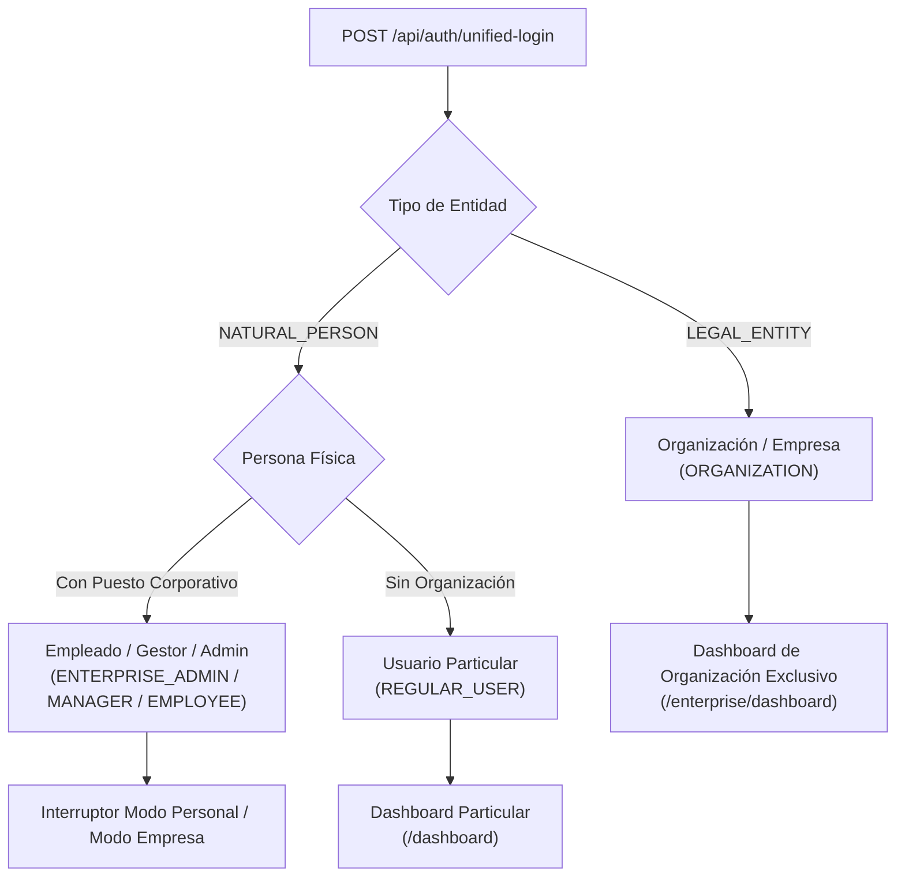
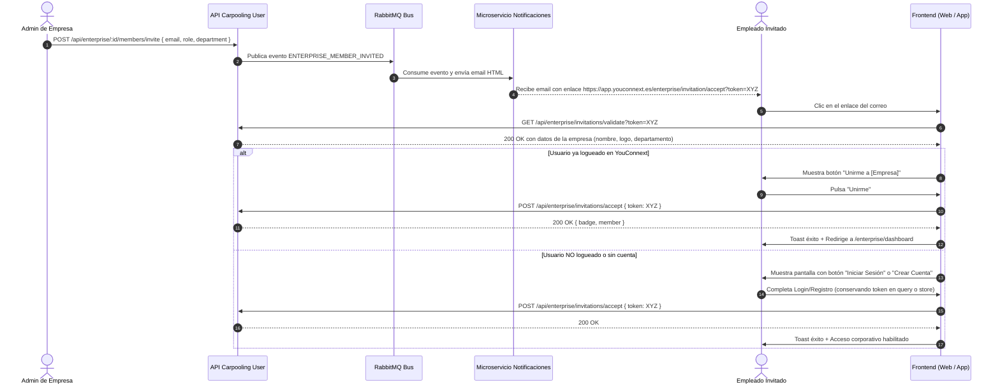

# Guía de Integración Frontend para Empresas y Organizaciones

Esta guía detalla la implementación práctica para los equipos de desarrollo de **Frontend Web** y **Aplicación Móvil** (React, React Native, Vue, Flutter, iOS y Android), cubriendo el flujo de autenticación unificada, gestión de estados, alternancia de dashboards corporativos, flujo de invitación de empleados y renderizado de eventos con R-Tree.

---

## 1. Modelo de Identidad YouConnext

En YouConnext existen dos tipos fundamentales de entidades:



1. **Persona Jurídica (`LEGAL_ENTITY`):**
   - Cuentas creadas directamente para la empresa (`cif`, `name`, `sector`).
   - `classification`: `"ORGANIZATION"`.
   - Operan **únicamente** en modo corporativo (`initial_mode: "enterprise"`). No tienen coches personales ni realizan viajes particulares.
2. **Persona Física con Puesto Corporativo (`NATURAL_PERSON`):**
   - Empleados, gestores de movilidad o administradores corporativos que poseen su propia cuenta de usuario en YouConnext (`dni`, coches personales, valoraciones, viajes).
   - Tienen una o más membresías activas vinculadas a empresas (`enterpriseMemberships`).
   - `classification`: `"ENTERPRISE_ADMIN"`, `"ENTERPRISE_MANAGER"` o `"ENTERPRISE_EMPLOYEE"`.
   - Tienen habilitada la capacidad de alternar entre su **Modo Personal** y su **Modo Corporativo** mediante el interruptor de interfaz (`permissions.can_switch_dashboard === true`).
3. **Persona Física Particular (`REGULAR_USER`):**
   - Usuarios convencionales sin vinculación empresarial.
   - `classification`: `"REGULAR_USER"`. Solo tienen acceso al modo personal.

---

## 2. Gestión del Estado de Autenticación (Auth State)

### Estructura Recomendada del Estado Global en TypeScript

```typescript
export type IdentityClassification =
  | "ORGANIZATION"
  | "ENTERPRISE_ADMIN"
  | "ENTERPRISE_MANAGER"
  | "ENTERPRISE_EMPLOYEE"
  | "REGULAR_USER"
  | "SUPER_ADMIN";

export type ActiveAppMode = "personal" | "corporate";

export interface CorporateMembership {
  enterprise_id: string;
  enterprise_name: string;
  corporate_role: "ADMIN" | "MANAGER" | "EMPLOYEE";
  corporate_role_title: string;
  department: string | null;
  employee_code: string | null;
  joined_at: string;
}

export interface AuthPermissions {
  can_access_personal_mode: boolean;
  can_access_corporate_mode: boolean;
  can_switch_dashboard: boolean;
  can_manage_enterprise: boolean;
  can_invite_members: boolean;
  can_remove_members: boolean;
  can_change_member_role: boolean;
  can_create_corporate_events: boolean;
  can_view_cae_metrics: boolean;
  can_access_corporate_routes: boolean;
}

export interface UnifiedAuthResponse {
  status: "Success" | "Error";
  message: string;
  token: string;
  refreshToken?: string | null;
  identity: {
    type: "LEGAL_ENTITY" | "NATURAL_PERSON";
    classification: IdentityClassification;
    user_id: string;
    email: string;
    display_name: string;
    avatar: string | null;
    system_role: string;
  };
  legal_entity: {
    enterprise_id: string;
    cif: string;
    name: string;
    sector: string | null;
    location: string | null;
    website: string | null;
    verified: boolean;
  } | null;
  natural_person: {
    dni: string | null;
    first_name: string | null;
    last_name: string | null;
    phone: string | null;
    is_driver: boolean;
    cars_count: number;
    is_corporate_member: boolean;
    primary_membership: CorporateMembership | null;
    memberships: CorporateMembership[];
  } | null;
  permissions: AuthPermissions;
  initial_mode: "personal" | "enterprise";
}
```

### Manejador de Login y Redirección en el Cliente

Al invocar `POST /api/auth/unified-login`:

```typescript
async function handleUnifiedLogin(credentials: { email: string; password?: string; id_token?: string }) {
  const response = await api.post<UnifiedAuthResponse>("/api/auth/unified-login", credentials);
  const data = response.data;

  // 1. Guardar token en storage seguro (SecureStore en móvil o localStorage/cookie en web)
  setAuthToken(data.token);

  // 2. Establecer el modo inicial de la interfaz
  const currentMode: ActiveAppMode = data.initial_mode === "enterprise" ? "corporate" : "personal";
  setAppMode(currentMode);

  // 3. Redirigir según el modo inicial
  if (data.initial_mode === "enterprise") {
    navigate("/enterprise/dashboard");
  } else {
    navigate("/dashboard");
  }
}
```

---

## 3. Alternancia de Dashboard (Dashboard Switcher)

Para los usuarios que son empleados o administradores (`permissions.can_switch_dashboard === true`), la barra superior de navegación (o el drawer lateral en móvil) debe incluir un botón o selector de modo:

### Componente de Selector (Ejemplo React / React Native)

```tsx
import React from "react";
import { useAuth } from "./context/AuthContext";
import { useNavigate } from "react-router-dom";

export const ModeSwitcher: React.FC = () => {
  const { permissions, appMode, setAppMode, naturalPerson } = useAuth();
  const navigate = useNavigate();

  // Solo mostrar el selector si el usuario tiene doble rol
  if (!permissions.can_switch_dashboard) {
    return null;
  }

  const toggleMode = () => {
    if (appMode === "personal") {
      setAppMode("corporate");
      navigate("/enterprise/dashboard");
    } else {
      setAppMode("personal");
      navigate("/dashboard");
    }
  };

  return (
    <div className="flex items-center gap-2 bg-slate-100 p-1 rounded-full border border-slate-200">
      <button
        onClick={toggleMode}
        className={`px-3 py-1 rounded-full text-xs font-semibold transition-all ${
          appMode === "personal"
            ? "bg-emerald-600 text-white shadow-sm"
            : "text-slate-600 hover:text-slate-900"
        }`}
      >
        🚗 Particular
      </button>
      <button
        onClick={toggleMode}
        className={`px-3 py-1 rounded-full text-xs font-semibold transition-all ${
          appMode === "corporate"
            ? "bg-indigo-600 text-white shadow-sm"
            : "text-slate-600 hover:text-slate-900"
        }`}
      >
        🏢 {naturalPerson?.primary_membership?.enterprise_name || "Empresa"}
      </button>
    </div>
  );
};
```

### Matriz de Visibilidad de Vistas por Permisos

| Vista / Acción en Frontend | Permiso requerido | Roles habilitados |
|---|---|---|
| Módulo de Métricas y Ahorro CAE | `permissions.can_view_cae_metrics` | `ORGANIZATION`, `ENTERPRISE_ADMIN`, `ENTERPRISE_MANAGER` |
| Creación de Eventos Corporativos | `permissions.can_create_corporate_events` | `ORGANIZATION`, `ENTERPRISE_ADMIN`, `ENTERPRISE_MANAGER` |
| Invitar Empleados por Correo | `permissions.can_invite_members` | `ORGANIZATION`, `ENTERPRISE_ADMIN` |
| Modificar Roles / Desvincular Empleados | `permissions.can_change_member_role` / `can_remove_members` | `ORGANIZATION`, `ENTERPRISE_ADMIN` |
| Editar Datos Fiscales de la Empresa | `permissions.can_manage_enterprise` | `ORGANIZATION`, `ENTERPRISE_ADMIN` |
| Ver Lista de Empleados de la Empresa | `role === 'MANAGER'` o `'ADMIN'` | `ENTERPRISE_MANAGER`, `ENTERPRISE_ADMIN`, `ORGANIZATION` |

---

## 4. Flujo de Invitaciones por Correo Electrónico



### Pantalla de Aceptación de Invitación (Ejemplo de Implementación)

Ruta en Frontend: `/enterprise/invitation/accept`

```tsx
import React, { useEffect, useState } from "react";
import { useSearchParams, useNavigate } from "react-router-dom";
import { useAuth } from "./context/AuthContext";
import api from "./services/api";

export const AcceptInvitationPage: React.FC = () => {
  const [searchParams] = useSearchParams();
  const token = searchParams.get("token");
  const navigate = useNavigate();
  const { isAuthenticated, refreshMemberships } = useAuth();

  const [loading, setLoading] = useState(true);
  const [invitation, setInvitation] = useState<any>(null);
  const [error, setError] = useState<string | null>(null);
  const [accepting, setAccepting] = useState(false);

  useEffect(() => {
    if (!token) {
      setError("Token de invitación no proporcionado.");
      setLoading(false);
      return;
    }

    // 1. Validar el token públicamente
    api
      .get(`/api/enterprise/invitations/validate?token=${token}`)
      .then((res) => {
        setInvitation(res.data.invitation);
      })
      .catch((err) => {
        setError(err.response?.data?.message || "La invitación no es válida o ha caducado.");
      })
      .finally(() => setLoading(false));
  }, [token]);

  const handleAccept = async () => {
    try {
      setAccepting(true);
      // 2. Aceptar la invitación vinculando al usuario autenticado
      const res = await api.post("/api/enterprise/invitations/accept", { token });
      
      // 3. Refrescar las membresías en el estado global
      await refreshMemberships();

      // 4. Mostrar feedback y redirigir
      alert(res.data.message || "¡Bienvenido a la organización!");
      navigate("/enterprise/dashboard");
    } catch (err: any) {
      alert(err.response?.data?.message || "Error al aceptar la invitación.");
    } finally {
      setAccepting(false);
    }
  };

  if (loading) return <div>Verificando invitación corporativa...</div>;
  if (error) return <div className="text-red-500 font-bold">{error}</div>;

  return (
    <div className="max-w-md mx-auto p-6 bg-white shadow-lg rounded-xl text-center">
      {invitation.enterprise?.logo && (
        
      )}
      <h2 className="text-2xl font-bold text-slate-800">
        Te han invitado a {invitation.enterprise?.name}
      </h2>
      <p className="text-slate-600 mt-2">
        Puesto: <span className="font-semibold">{invitation.role}</span>
        {invitation.department && ` — Departamento: ${invitation.department}`}
      </p>

      {isAuthenticated ? (
        <button
          onClick={handleAccept}
          disabled={accepting}
          className="mt-6 w-full py-3 bg-indigo-600 text-white font-bold rounded-lg hover:bg-indigo-700 transition"
        >
          {accepting ? "Vinculando..." : "Aceptar y Unirme a la Organización"}
        </button>
      ) : (
        <div className="mt-6">
          <p className="text-sm text-slate-500 mb-3">
            Inicia sesión o regístrate en YouConnext para aceptar esta invitación:
          </p>
          <button
            onClick={() => navigate(`/login?redirect=/enterprise/invitation/accept?token=${token}`)}
            className="w-full py-2 bg-emerald-600 text-white font-semibold rounded-lg hover:bg-emerald-700"
          >
            Iniciar Sesión / Registrarme
          </button>
        </div>
      )}
    </div>
  );
};
```

---

## 5. Renderizado de Eventos en Tarjetas (`EventCard`) con R-Tree

Los eventos devueltos por `GET /api/events` y `GET /api/events/nearby` contienen la propiedad normalizada `is_corporate: boolean` y la información completa del organizador.

### Componente de Tarjeta de Evento (`EventCard`)

```tsx
import React from "react";

export interface EventItem {
  id: string;
  name: string;
  unique_code: string;
  latitude: number;
  longitude: number;
  distance_km?: number;
  is_corporate: boolean;
  start_date: string;
  end_date: string;
  total_participants?: number;
  participants_count?: number;
  company?: {
    id: string;
    name: string;
    logo: string | null;
    website: string | null;
  } | null;
  tags?: Array<{ tag: { id: number; name: string } }>;
}

export const EventCard: React.FC<{ event: EventItem; onSelect: (e: EventItem) => void }> = ({
  event,
  onSelect,
}) => {
  return (
    <div
      onClick={() => onSelect(event)}
      className={`p-4 rounded-xl border transition-all cursor-pointer hover:shadow-md ${
        event.is_corporate
          ? "border-indigo-200 bg-gradient-to-br from-white to-indigo-50/40"
          : "border-slate-200 bg-white"
      }`}
    >
      <div className="flex items-center justify-between mb-2">
        {/* Badge Corporativo vs Público */}
        {event.is_corporate ? (
          <span className="inline-flex items-center gap-1 px-2.5 py-0.5 rounded-full text-xs font-bold bg-indigo-100 text-indigo-800">
            🏢 Corporativo
          </span>
        ) : (
          <span className="inline-flex items-center gap-1 px-2.5 py-0.5 rounded-full text-xs font-semibold bg-emerald-100 text-emerald-800">
            🌱 Público
          </span>
        )}

        {/* Indicador de Proximidad R-Tree */}
        {typeof event.distance_km === "number" && (
          <span className="text-xs font-medium text-slate-500">
            📍 {event.distance_km < 1
              ? `${Math.round(event.distance_km * 1000)} m`
              : `${event.distance_km.toFixed(1)} km`}
          </span>
        )}
      </div>

      <h3 className="text-lg font-bold text-slate-900 line-clamp-1">{event.name}</h3>

      {/* Empresa Organizadora */}
      {event.company && (
        <div className="flex items-center gap-2 mt-2">
          {event.company.logo ? (
            
          ) : (
            <div className="w-5 h-5 rounded-full bg-slate-300 flex items-center justify-center text-[10px] font-bold">
              {event.company.name.charAt(0)}
            </div>
          )}
          <span className="text-xs text-slate-600 font-medium truncate">
            {event.company.name}
          </span>
        </div>
      )}

      {/* Código de Evento y Fecha */}
      <div className="flex items-center justify-between mt-4 pt-3 border-t border-slate-100 text-xs text-slate-500">
        <span>Código: <strong className="font-mono text-slate-700">{event.unique_code}</strong></span>
        {typeof event.participants_count === "number" && (
          <span className="font-semibold text-indigo-600">👥 {event.participants_count} inscritos</span>
        )}
        <span>{new Date(event.start_date).toLocaleDateString()}</span>
      </div>
    </div>
  );
};
```

---

## 6. Manejo de Errores y Salvaguardas en Frontend

| Código HTTP | Escenario | Mensaje Recomendado al Usuario |
|---|---|---|
| `400 Bad Request` | Intento de degradar o eliminar al único administrador activo | *"Operación no permitida: La organización debe contar con al menos un administrador activo. Asigna otro administrador antes de modificar o desvincular a este usuario."* |
| `400 Bad Request` | Token de invitación expirado (> 7 días) | *"Esta invitación ha caducado. Ponte en contacto con el administrador de tu empresa para que te envíe una nueva invitación."* |
| `400 Bad Request` | Token de invitación ya aceptado | *"Esta invitación ya ha sido aceptada previamente."* |
| `403 Forbidden` | Acceso denegado a funciones de gestión de miembros | *"No dispones de permisos de Administrador para gestionar empleados en esta organización."* |
| `403 Forbidden` | Cuenta de organización o de usuario desactivada / eliminada | *"Esta cuenta ha sido desactivada. Contacta con el equipo de soporte de YouConnext."* |
